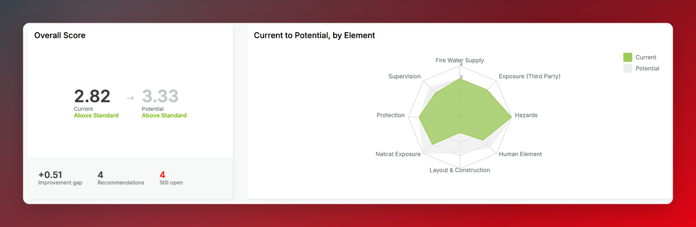

Risk classifications are how engineers rate the quality of risk controls and conditions at a site. Scores from individual classifications roll up into an overall survey score, which in turn drives the score for the site and client.

To view a survey's classifications, open the survey record and go to the **Risk Classification** tab. The tab opens in view mode. To enter or change classifications, click **Edit Risk Classification**.

<Info>
  The specific risk elements available depend on the survey type. Different survey types have different classification structures and scoring methodologies.
</Info>

## Score overview

The top of the Risk Classification tab gives you an at-a-glance summary of the survey's score. It's shown for every survey type.

### Overall Score

The **Overall Score** card shows the survey's **current** score and classification. For Property surveys, it also shows the **potential** score and classification — the score the site could reach if the recommended improvements are made. Energy surveys don't have a potential score (see [Energy surveys](#energy-surveys)).

Below the scores are these figures:

| Figure | Description |
|--------|-------------|
| Improvement gap | *Property surveys only.* The difference between the potential and current scores |
| Recommendations | The number of recommendations linked to the survey's risk elements |
| Still open | How many of those recommendations are still open |

### Current to Potential, by Element

This radar chart compares the current and potential scores for each **top-level** risk element, with one axis per element. The current score is filled in the colour of the survey's current classification (for example, green for Above Standard or red for Poor), with the potential score shown in grey behind it. The bigger the gap between the two shapes on an axis, the more room for improvement in that element. For Energy surveys, the chart shows the current score only.

## Risk elements

The Risk Classification page displays a hierarchical table of **Risk Elements** — the categories and sub-categories that the engineer scores. The specific elements available depend on the survey type configured for that survey.

The **Recs** column shows how many recommendations are linked to each element and how many of them are still open. On Energy surveys, recommendations aren't linked to risk elements.

The other table columns vary by survey type, as described in the sections below.

## Property surveys

For Property surveys, the engineer rates each scorable element using two dropdowns — one for the site's **current** condition and one for its **potential** condition if recommended improvements are implemented.

| Column | Description |
| --- | --- |
| Current Classification | The engineer's rating of the site's current condition |
| Potential Classification | The engineer's rating of the site's potential if recommendations are implemented |
| Current Score | Numerical score calculated from the current classification |
| Potential Score | Numerical score calculated from the potential classification |

For each scorable element, the engineer selects from a set of rating options that range from the lowest to the highest standard of risk control. Each selection is converted to a numerical score automatically.

<Info>
  Leaving a classification blank is treated as **not applicable** — it is excluded from the score calculation entirely, not counted as zero. This ensures that elements which don't apply to a site don't unfairly affect the overall score.
</Info>

## Energy surveys

Energy surveys use a different scoring model from Property surveys. Instead of choosing a current and potential classification, the engineer enters two scores for each scorable element, and TruRisk calculates the current score from them.

| Column | Description |
| --- | --- |
| System Score | A rating from **0** to **4** of how well the site's systems are designed and set up to manage that risk element |
| Compliance Score | A percentage from **0%** to **100%** (in 10% steps) of how well the site actually follows those systems in practice |
| Current Score | Calculated automatically as **System Score × Compliance Score** |
| Current Classification | The classification band for the current score |

For example, a System Score of **3** with a Compliance Score of **80%** gives a Current Score of **2.4**. This separates the quality of a site's risk management systems from how well they're followed: a well-designed system that isn't followed scores lower than the same system applied consistently.

Energy surveys only have a **current** score. There is no potential score or potential classification.

<Info>
  As with Property surveys, leaving both inputs blank for an element treats it as **not applicable** and excludes it from the score calculation.
</Info>

## Hierarchical scoring

Risk elements are organised in a hierarchy for both survey types. Some elements are **parent rows** that group related sub-classifications beneath them. The rules are:

- **Leaf-level elements** (those with no children) are the ones the engineer scores directly.
- **Parent elements** do not have direct score inputs. Their score is automatically calculated as the **weighted average** of all their scored children.
- There can be multiple levels of nesting — a parent can itself be nested under another parent.
- The **Overall** row at the bottom of the table shows the weighted average across all top-level elements, and represents the final score for the survey.

## Narratives

A free-text narrative can be added to any classification level using the **Add Narrative** link. Narratives are visible in the editor and can be shown or hidden using the **Hide/Show Narratives** toggle at the top of the page.

## Engineer classification override

Below the Risk Elements table is an **Engineer Classification** section. It's always shown in edit mode; in view mode it only appears if the engineer has entered an override. This allows the engineer to manually override the calculated overall classification with their own professional judgement — for example, if they believe the calculated score doesn't fully reflect the site's risk profile. A narrative can also be added to explain the override.

## How scores roll up

Scores from individual risk classifications feed into a broader scoring hierarchy:

1. **Survey score** — the weighted average of all top-level risk elements in the survey (the Overall row).
2. **Site score** — the score from the site's most recent survey with a status of **Report issued** becomes the current score for that site.
3. **Client score** — calculated as the weighted average of all sites in the client record, weighted by each site's **Total Insured Value (TIV)**. Sites with higher TIV have a proportionally greater influence on the client's overall score.

The resulting scores are displayed as the **Site Score** on the site record and the **Client Score** on the client record.

<Warning>
  Site and client classifications and scores only update when a survey's status is set to **Report issued**. While a survey is in any other status, changes you make on its Risk Classification tab are saved to the survey but don't change the site or client classification. If the site or client record still shows the old classification, check the survey's status. See [Issuing a survey report](/issuing-a-survey-report).
</Warning>
